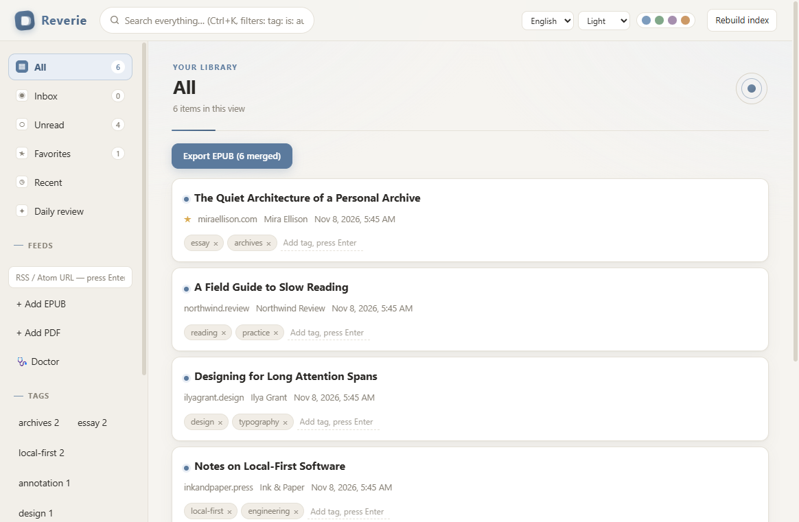
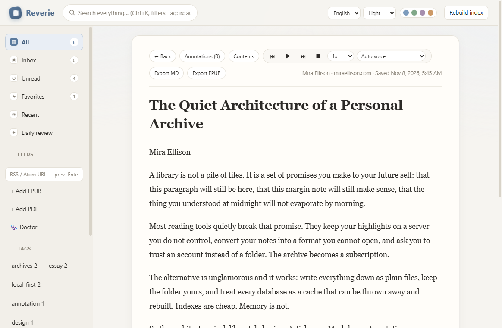
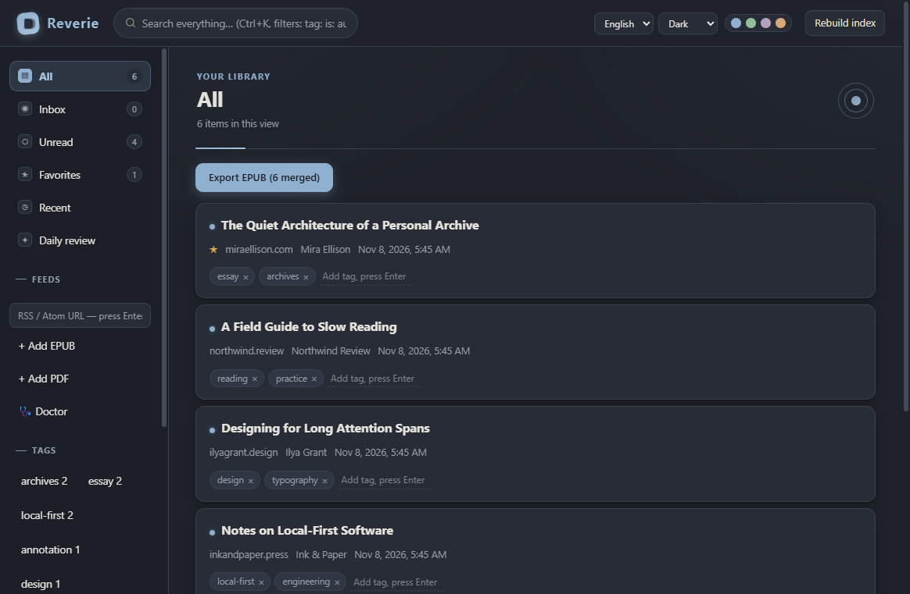
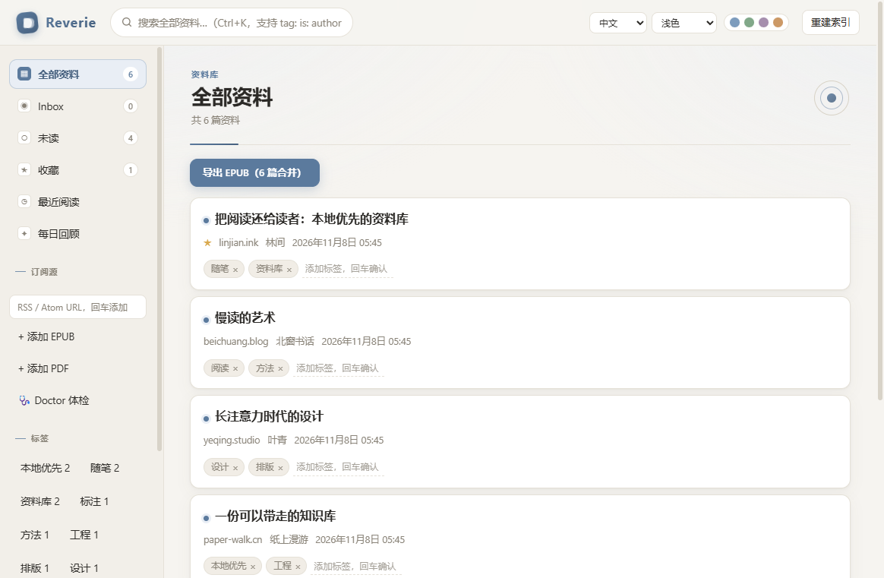
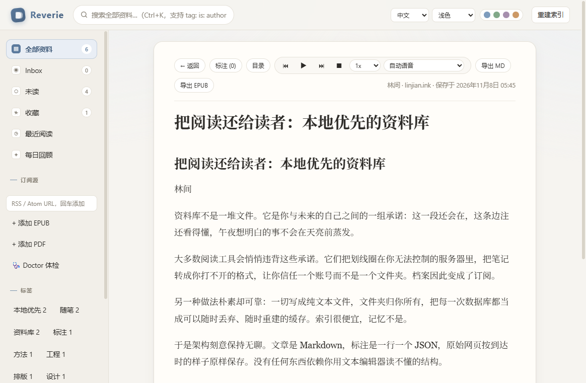
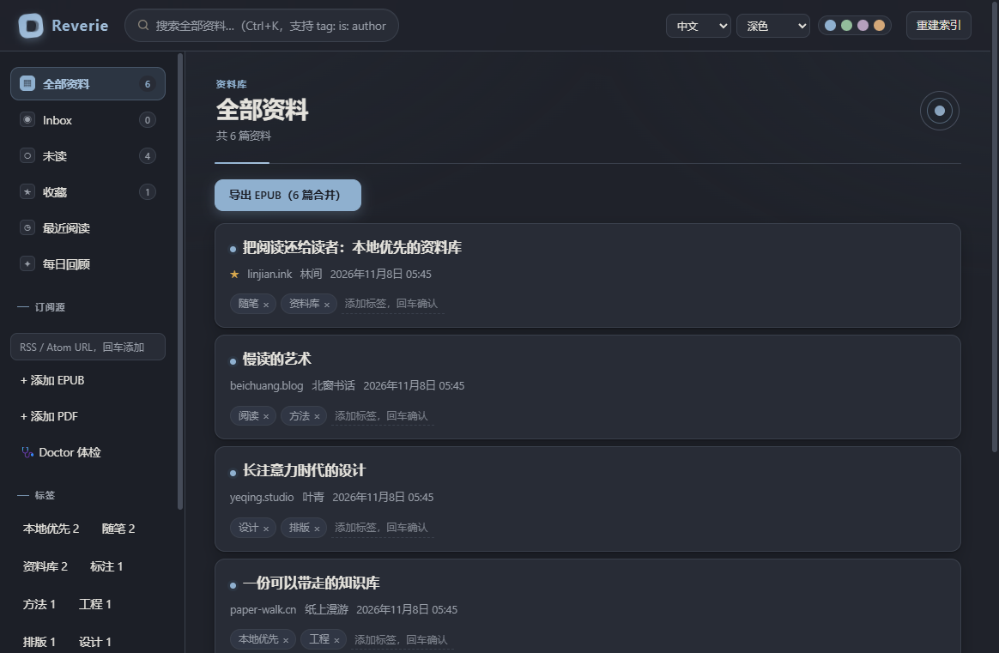

<div align="center">

# ifuyo Reverie

**A Windows-first, local-first, file-native personal reading archive.**

*Your library is a folder, not an account.*

[English](#english) · [简体中文](#简体中文)

</div>

---

## English

Reverie turns web pages, RSS feeds, EPUB books, PDFs, highlights and notes into a reading archive
you actually own: plain files you can copy, back up, search, and still open ten years from now.

```text
discover → save → read → highlight → note → bookmark → archive → search → re-read → listen
```



### Screenshots

| Reader | Dark mode |
| :---: | :---: |
| [](docs/screenshots/en-reader.png) | [](docs/screenshots/en-dark.png) |

### What's in 1.0

| Capability | Detail |
| --- | --- |
| **Reading** | Web articles (readability extraction + sanitization), RSS/Atom, EPUB 2/3 and PDF share one Reader shell; reading position is restored across sessions |
| **Annotation** | Highlights, notes and position bookmarks. When an anchor can no longer be resolved the annotation becomes *Orphaned* — visibly, never silently deleted |
| **Search** | Title, author, body, annotations, tags and URL, with `tag:` `is:` `in:` `author:` filter syntax and per-match context |
| **Read aloud** | Windows local voices, adjustable rate, voice selection, sentence-level follow-along |
| **Import / export** | Pocket / Wallabag / Raindrop import (idempotent); Markdown, EPUB 3, metadata and highlights export; daily review |
| **Data safety** | Files are the source of truth (JSON / Markdown / JSONL / original files); the index is rebuildable; atomic writes; a Doctor health check with graded repair; future-format files open read-only; the whole library can be copied and moved |
| **Windows productization** | Portable build and NSIS installer, single instance, "open with" file arguments, bounded logs |
| **Browser capture** | Edge / Chrome extension with a fixed extension ID and a native-messaging host — right-click any article to archive it |

### Quick start

```bash
npm install      # Node >= 22
npm run app      # development mode
```

### Build a Windows release

```bash
npm run package:portable
# → artifacts/Reverie-1.0.0-portable-win-x64/ (Reverie.exe) + .zip + checksums
```

Copy `Reverie-1.0.0-portable-win-x64/` to any Windows x64 machine and run it. Your library lives in
a folder you choose (default `%LOCALAPPDATA%\Reverie\library`), completely separate from the
application directory — copying the library folder *is* the backup and the migration.

### Verify

```bash
npm test                 # 312 tests
npm run doctor           # library health check (--repair applies safe fixes)

npm run smoke:pdf        # end-to-end: PDF
npm run smoke:tts        # end-to-end: read aloud
npm run smoke:epub       # end-to-end: EPUB export
npm run smoke:doctor     # end-to-end: corrupt → repair
npm run smoke:ui         # end-to-end: theme + language switching
npm run smoke:journey    # end-to-end: full user journey
npm run smoke:release    # end-to-end: the packaged build

npm run shots            # regenerate the screenshots in this README
```

### How the data is organized

```text
library/
  <document-id>/
    meta.json         # title, author, source, captured-at …
    article.md        # canonical content (Markdown)
    annotations.jsonl # one JSON object per line
    original.*        # the page or file exactly as it arrived
user-state.json       # read / favorite / inbox / tags / reading position
```

Everything except the original files is plain text and diff-friendly. Delete the derived index and
caches at any time — Reverie rebuilds them from the library.

### Documentation

| Document | Contents |
| --- | --- |
| [docs/WINDOWS.md](docs/WINDOWS.md) | Install, paths, browser integration, backup (user guide) |
| [docs/RECOVERY-AND-DOCTOR.md](docs/RECOVERY-AND-DOCTOR.md) | Recovery semantics and Doctor |
| [docs/EPUB-EXPORT.md](docs/EPUB-EXPORT.md) · [docs/TTS.md](docs/TTS.md) · [docs/PDF.md](docs/PDF.md) | Capability notes |
| [docs/M12-FINAL-AUDIT.md](docs/M12-FINAL-AUDIT.md) | 1.0 final audit (Gates A–J) |
| [docs/POST-1.0.md](docs/POST-1.0.md) | Known issues and roadmap |
| [docs/FINAL-ARCHITECTURE.md](docs/FINAL-ARCHITECTURE.md) | Architecture overview |
| [docs/FORMAT.md](docs/FORMAT.md) | Library file format specification (source of truth) |
| [docs/DECISIONS.md](docs/DECISIONS.md) · [docs/PROGRESS.md](docs/PROGRESS.md) | Decision log · milestones |
| [THIRD_PARTY.md](THIRD_PARTY.md) | Dependency and license audit |

### Principles

- **Files are the truth.** Indexes, caches and settings are derived data and can be rebuilt at any time.
- **The data belongs to the user.** Open formats (JSON / Markdown / JSONL / original files) that can be
  backed up, migrated, and used without Reverie. Uninstalling or upgrading never touches your library.
- **Local first.** The network is used only to save pages and fetch RSS — no cloud dependency, no
  accounts, no telemetry.
- **Reading first.** Every design decision serves the comfort, stability and recoverability of long
  reading sessions.

---

## 简体中文

Reverie 把网页、RSS、EPUB、PDF、划线与笔记保存为属于你自己的、可迁移、可长期维护的阅读档案：
纯文件，可复制、可备份、可搜索，十年后依然打得开。

```text
发现 → 保存 → 阅读 → 划线 → 记录 → 书签 → 归档 → 搜索 → 再次阅读 → 听读
```



### 界面截图

| 阅读器 | 深色主题 |
| :---: | :---: |
| [](docs/screenshots/zh-reader.png) | [](docs/screenshots/zh-dark.png) |

### 1.0 能力

| 能力 | 说明 |
| --- | --- |
| **阅读** | 网页文章（正文提取 + 净化）、RSS/Atom、EPUB 2/3、PDF 共用一套 Reader Shell；阅读进度跨会话恢复 |
| **标注** | 划线高亮、笔记、位置书签。定位失败时标注转为 *Orphaned*——明确标记，绝不静默删除 |
| **搜索** | 标题 / 作者 / 正文 / 标注 / 标签 / URL，支持 `tag:` `is:` `in:` `author:` 过滤语法与逐条命中上下文 |
| **TTS 有声阅读** | Windows 本地语音、可调语速、语音选择、句子级定位跟随 |
| **导入 / 导出** | Pocket / Wallabag / Raindrop 导入（幂等）；Markdown、EPUB 3、Metadata、Highlights 导出；每日回顾 |
| **数据安全** | 文件即真相（JSON / Markdown / JSONL / 原始文件）；索引可重建；原子写入；Doctor 体检与分级修复；未来格式只读保护；整库可复制迁移 |
| **Windows 产品化** | Portable 构建与 NSIS 安装包、单实例、文件参数打开、有界日志 |
| **浏览器采集** | Edge / Chrome 扩展（固定扩展 ID）+ Native Messaging Host——右键任意文章即可归档 |

### 快速开始

```bash
npm install      # 需要 Node >= 22
npm run app      # 开发模式启动
```

### 构建 Windows 发布版

```bash
npm run package:portable
# → artifacts/Reverie-1.0.0-portable-win-x64/（Reverie.exe）+ .zip + checksums
```

把 `Reverie-1.0.0-portable-win-x64/` 复制到任意 Windows x64 机器即可运行。用户资料保存在自选的
库目录（默认 `%LOCALAPPDATA%\Reverie\library`），与应用目录完全分离——复制库文件夹即完成备份与迁移。

### 验证

```bash
npm test                 # 312 项测试
npm run doctor           # 库健康体检（--repair 执行安全修复）

npm run smoke:pdf        # 真机冒烟：PDF 全链路
npm run smoke:tts        # 真机冒烟：TTS 旅程
npm run smoke:epub       # 真机冒烟：EPUB 导出
npm run smoke:doctor     # 真机冒烟：损坏注入 → 修复
npm run smoke:ui         # 真机冒烟：主题与语言切换
npm run smoke:journey    # 真机冒烟：完整用户旅程
npm run smoke:release    # 真机冒烟：打包产物

npm run shots            # 重新生成本文档中的界面截图
```

### 数据结构

```text
library/
  <document-id>/
    meta.json         # 标题、作者、来源、采集时间…
    article.md        # canonical 正文（Markdown）
    annotations.jsonl # 一行一个 JSON
    original.*        # 网页或文件的原样副本
user-state.json       # 已读 / 收藏 / Inbox / 标签 / 阅读位置
```

除原始文件外全部是纯文本，可 diff、可 grep。派生索引与缓存随时可以删除——Reverie 会从库文件重建。

### 文档

| 文档 | 内容 |
| --- | --- |
| [docs/WINDOWS.md](docs/WINDOWS.md) | 安装 / 路径 / 浏览器集成 / 备份（用户指南） |
| [docs/RECOVERY-AND-DOCTOR.md](docs/RECOVERY-AND-DOCTOR.md) | 恢复语义与 Doctor |
| [docs/EPUB-EXPORT.md](docs/EPUB-EXPORT.md) · [docs/TTS.md](docs/TTS.md) · [docs/PDF.md](docs/PDF.md) | 能力说明 |
| [docs/M12-FINAL-AUDIT.md](docs/M12-FINAL-AUDIT.md) | 1.0 最终审计（Gate A–J） |
| [docs/POST-1.0.md](docs/POST-1.0.md) | 已知问题与未来路线 |
| [docs/FINAL-ARCHITECTURE.md](docs/FINAL-ARCHITECTURE.md) | 最终架构总览 |
| [docs/FORMAT.md](docs/FORMAT.md) | Library 文件格式规范（Source of Truth） |
| [docs/DECISIONS.md](docs/DECISIONS.md) · [docs/PROGRESS.md](docs/PROGRESS.md) | 决定记录 / 里程碑 |
| [THIRD_PARTY.md](THIRD_PARTY.md) | 第三方依赖与许可证审计 |

### 原则

- **文件是真相**：索引 / 缓存 / 设置只是派生数据，可随时重建。
- **数据属于用户**：开放格式（JSON / Markdown / JSONL / 原始文件），可备份、可迁移、可脱离 Reverie 使用；
  卸载或升级永不触碰用户库。
- **本地优先**：网络只用于保存网页与获取 RSS，不制造云依赖；无账号、无遥测。
- **阅读优先**：一切设计服从长时间阅读的舒适性、稳定性、可恢复性。

---

## License

Reverie is dual-licensed — use it under **either** of the following, at your option:

- **Apache License 2.0** — see [`LICENSE-APACHE`](LICENSE-APACHE)
- **MIT License** — see [`LICENSE-MIT`](LICENSE-MIT)

Unless you explicitly state otherwise, any contribution intentionally submitted for inclusion in
this project shall be dual-licensed as above, without any additional terms or conditions.

Third-party components remain under their own licenses; see [`THIRD_PARTY.md`](THIRD_PARTY.md) and
the upstream license files under `app/vendor/`.

`SPDX-License-Identifier: (Apache-2.0 OR MIT)`

## Security

This section is intentionally English-only.

Reverie treats all external content as untrusted input and keeps the archive on local disk. Please
report vulnerabilities **privately** — do not open a public issue.

- Policy, scope and safe harbor: [`SECURITY.md`](SECURITY.md)
- Threat model and per-subsystem rules: [`docs/SECURITY.md`](docs/SECURITY.md)

Supported versions: **1.0.x**.
